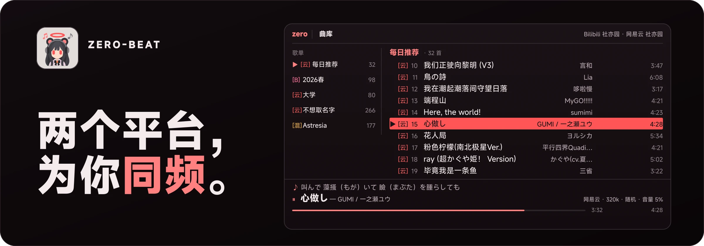
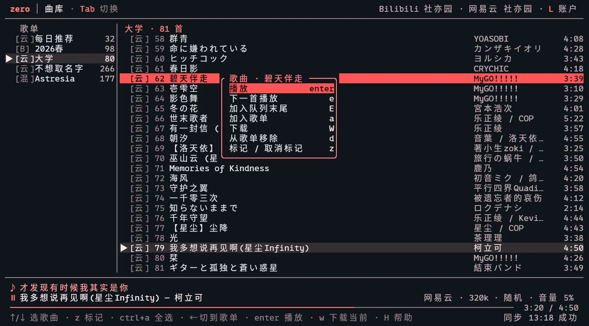
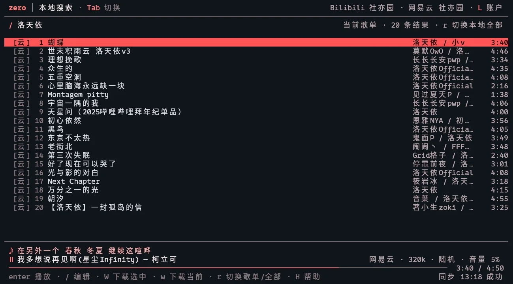
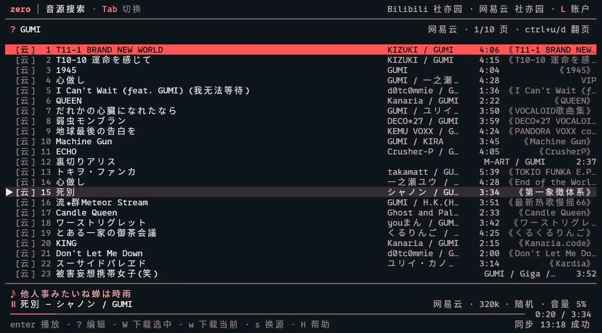
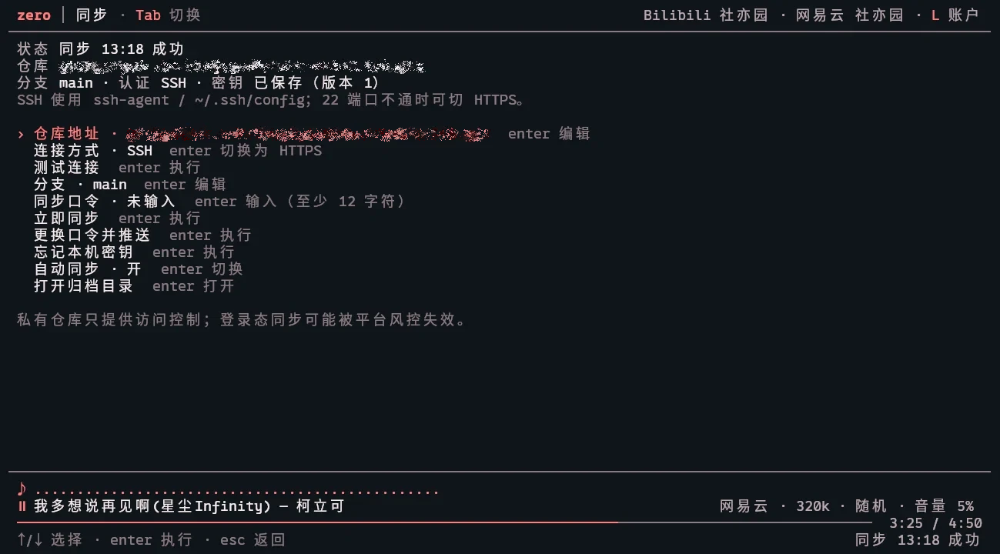

# zero-beat · 零拍

<p align="center">
  
</p>

**B 站 + 网易云音乐终端播放器。** 在同一个终端里搜索、收藏、排队、播放两个平台的音频。

> 名字取自无线电里的 *zero beat*，两个振荡器频率相同时，差拍归零。

> 这个项目延续了 [Half Beat Player](https://github.com/Sheyiyuan/Half-Beat-Player) 在电脑上听 B 站视频的初衷，界面和交互也参考了 [go-musicfox](https://github.com/go-musicfox/go-musicfox)。欢迎提交 issue 和 PR。

> **v0.7.0 已发布。** 这个版本加入本地音乐库（文件夹即只读歌单）、本地歌词识别与歌词来源手动绑定，并把同步仓库升级到 v2（仅本机数据不再进仓库）。多设备用户请先升级所有设备再同步。改动见 [v0.7.0 发布说明](docs/release-notes-v0.7.0.md)，更远的计划见 [ROADMAP.md](ROADMAP.md)。

---

## 主要功能

- **两个平台一起听**：B 站和网易云各自扫码登录，可以分开搜，也可以合在一起搜；播放队列和本地歌单都能混着放两边的歌。
- **本机音乐也进曲库**：`zero library add ~/Music` 或命令面板「添加本地文件夹」，目录即只读歌单。只扫当前层、可重扫、不监听；下载目录也能直接当文件夹歌单用，不会多出一份重复曲目。
- **歌单随你**：收藏夹和远端歌单按需导入，本地歌单想新建、改名、增删都行；混合歌单还能引用多个歌单再追加自己的曲目。文件夹歌单与「仅本机歌单」留在本机，不进同步。
- **播放顺心**：优先无损或高音质，支持播放片段、全局/单曲音量补偿、自动响度均衡、睡眠定时；退出再打开，接着上次的地方继续听。
- **歌词跟上**：平台歌词、本地 `.lrc` 与内嵌歌词、LRCLIB 依次兜底；匹配不准时按 `B` 手动指定平台、LRCLIB、本地文件或另一首本机曲目，逐行高亮，偏移跟着当前歌词来源走。
- **下载后离线听**：界面里批量下载、统一管理，也可以命令行下；下载文件无损封装、带好歌曲信息，已下载的歌优先播本地。
- **多台设备同步**：歌单、键位、歌词偏移、歌词绑定和加密后的登录态存进你自己的 git 仓库，冲突时逐项选保留哪边，平时自动同步。文件夹歌单、仅本机歌单与本地歌词绑定不会进仓库。
- **融入系统**：Linux 下接入系统媒体面板和媒体键，桌面也能控制播放；内置红蓝两套配色、深浅模式跟随终端，颜色和快捷键都可以自定义。

界面截图、键位与逐项行为见下面的文档地图。

## 界面

主界面是曲库，左栏歌单、右栏曲目，底部常驻歌词和播放条；曲目前的 `[B]` / `[云]` 标着来源，歌单前的 `[夹]` / `[仅]` 分别表示文件夹歌单与仅本机歌单，左上角提示 `Tab` 切换页面。

[](docs/images/library.webp)

右键歌曲可以打开操作菜单：下一首播放、加入队列或歌单、下载、从歌单移除、标记。

[](docs/images/menu.webp)

歌词页、队列页、搜索页：

[](docs/images/lyrics.webp)
[](docs/images/queue.webp)
[](docs/images/search.webp)
[](docs/images/search-source.webp)

同步页（`ctrl+s`）集中管理仓库、分支、连接方式、密钥和自动同步，右下角的同步状态也能直接点开。Linux 下封面只在系统媒体面板显示，不占终端。

[](docs/images/sync.webp)

## 快速开始

```bash
curl -fsSLO https://github.com/Sheyiyuan/zero-beat/releases/latest/download/install.sh
sh install.sh
zero
```

装完还需要系统 `ffmpeg` 负责音频解码。进界面后按 `L` 扫码登录，`f` 导入歌单，`enter` 播放；想先看看界面长什么样，跑 `zero demo` 就行。

官方支持 Linux 和 macOS，Arch 有 AUR 包 `zero-beat-bin`（预编译二进制）与 `zero-beat-git`（跟随 main 源码构建）；Windows 提供了 zip 包，需要自己准备好 ffmpeg 和终端环境。

## 文档

在线文档：<https://sheyiyuan.github.io/zero-beat/>

具体指南放在 `docs/` 下。

### 使用指南

| 文档                                       | 内容                                                            |
| ------------------------------------------ | --------------------------------------------------------------- |
| [安装与依赖](docs/guide/install.md)        | 依赖、平台支持、安装脚本、AUR、源码构建、桌面入口               |
| [快速上手](docs/guide/quickstart.md)       | 首次启动、扫码登录、视图轮转、第一次播放、断点恢复              |
| [曲库、歌单与搜索](docs/guide/library.md)  | 本地/音源搜索、导入收藏、本地歌单、本地文件夹歌单、仅本机歌单、混合歌单、云端写入、批量选择 |
| [播放、队列与歌词](docs/guide/playback.md) | 音质、全局/单曲音量补偿、自动响度均衡、播放模式、队列、片段、本地歌词、歌词来源绑定、歌词页、睡眠定时 |
| [下载与本地优先](docs/guide/download.md)   | TUI 下载、下载管理页、本地优先、CLI 下载参数                    |
| [跨设备同步](docs/guide/sync.md)           | 同步页与冲突页、SSH/HTTPS、自动同步、安全模型                   |
| [系统媒体与封面](docs/guide/sysmedia.md)   | Linux 系统媒体面板、封面缓存、单实例                            |
| [主题](docs/guide/theme.md)                | 佐洛红 / 半拍蓝、深色/浅色、自定义颜色                          |
| [已知限制](docs/guide/limitations.md)      | 音源、播放、下载、同步、平台、终端各处的边界                    |
| [数据与隐私](docs/guide/privacy.md)        | 本地存储、网络访问、同步加密、免责声明                          |

### 参考

| 文档                                     | 内容                                       |
| ---------------------------------------- | ------------------------------------------ |
| [按键速查](docs/reference/keys.md)       | 默认键位全表、鼠标、媒体键                 |
| [自定义快捷键](docs/reference/keymap.md) | `keymap.toml`、动作 ID、冲突处理与版本迁移 |
| [CLI 子命令](docs/reference/cli.md)      | 全部子命令、环境变量、数据目录位置         |

### 开发

| 文档                                             | 内容                                           |
| ------------------------------------------------ | ---------------------------------------------- |
| [ARCHITECTURE.md](ARCHITECTURE.md)               | 分层、模块清单、数据流、关键契约、事件循环约束 |
| [docs/adr/](docs/adr/README.md)                  | 架构决策记录（含废弃与修订）                   |
| [docs/sync-design.md](docs/sync-design.md)       | 同步设计、威胁模型与实施拆分                   |
| [开发与发布](docs/guide/development.md)          | `make check`、UI 帧尺寸测试、GoReleaser、AUR   |
| [ROADMAP.md](ROADMAP.md)                         | 已完成与下一步                                 |
| [THIRD_PARTY_NOTICES.md](THIRD_PARTY_NOTICES.md) | 第三方依赖与许可                               |

## 第三方

主要依赖 [go-musicfox/netease-music](https://github.com/go-musicfox/netease-music)（MIT）和系统 [FFmpeg](https://ffmpeg.org/)，FFmpeg 需要另外安装。完整的许可说明见 [THIRD_PARTY_NOTICES.md](THIRD_PARTY_NOTICES.md)。

## 免责声明

本项目仅供学习、研究与技术交流，不用于商业用途。B 站与网易云的音频、封面、商标等内容版权归对应平台及权利人所有，本项目不托管任何音源内容；使用可能遇到账号风控、封禁、接口失效或数据丢失，风险自担。完整条款见 [数据与隐私](docs/guide/privacy.md#免责声明)。

本项目与 B 站、网易云官方无关联，也未获得其授权或认可。

## 许可证

[AGPL-3.0](LICENSE)。
