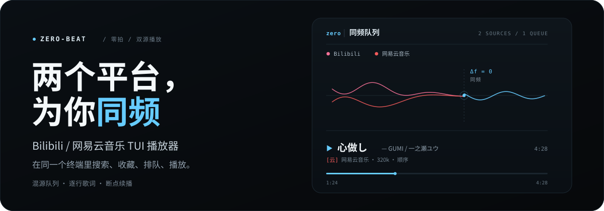
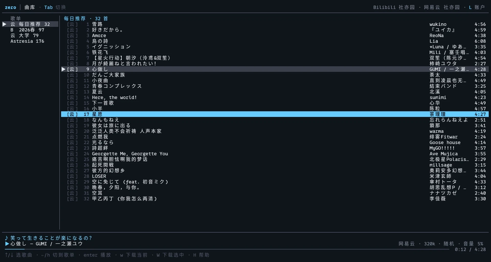
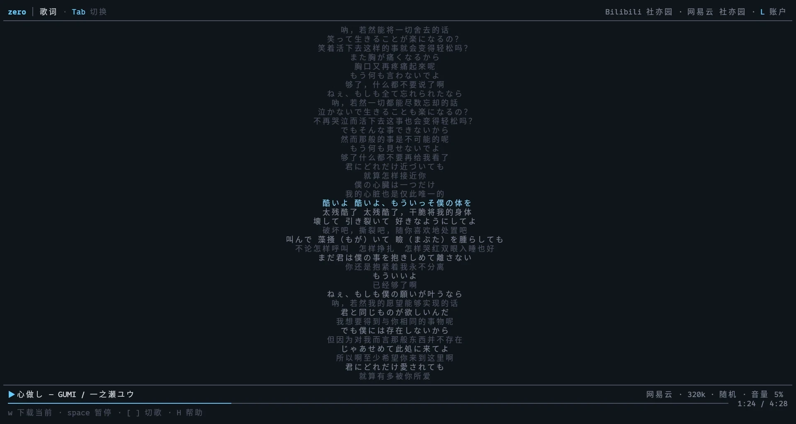
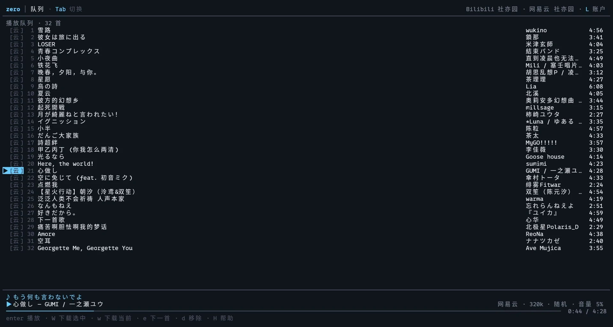
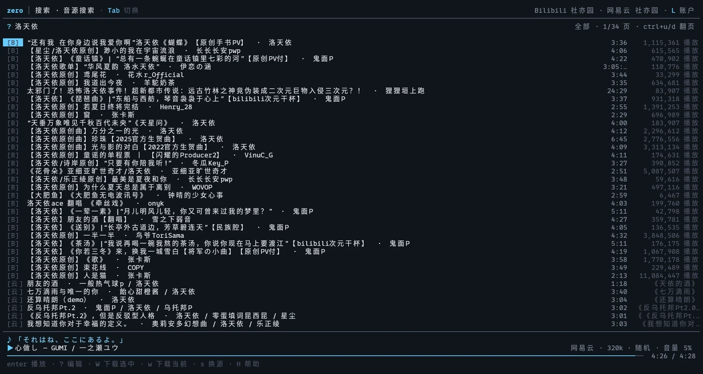

# zero-beat · 零拍

<p align="center">
  
</p>

**B 站 + 网易云音乐终端播放器。** 在同一个终端里搜索、收藏、排队、播放两个平台的音频，带逐行歌词。

> 名字取自无线电里的 *zero beat*：两个振荡器频率完全相同时差拍归零，听不出接缝。

> 本项目是 [Half Beat Player](https://github.com/Sheyiyuan/Half-Beat-Player) 的续作（至少是精神续作），延续「在电脑上听 B 站视频」的出发点；TUI 形态与播放器交互受到 [go-musicfox](https://github.com/go-musicfox/go-musicfox) 的启发。项目以个人使用为主，不承诺功能路线图、平台兼容性或问题响应速度，欢迎 issue 和 PR。

> **状态：v0.5.0 已发布**（[下载](https://github.com/Sheyiyuan/zero-beat/releases)）。双源已打通：B 站 + 网易云扫码登录、单源/合并搜索、收藏夹与歌单、混源队列、本地混源歌单、播放、歌词、断点恢复、下一首预解析；v0.4 加入播放片段、同源云端歌单写入与歌单引用混入；v0.5 补齐下载管理与本地优先播放，并重做鼠标交互、歌词页中央焦点与列表滚动。升级前请先看 [Release 说明](https://github.com/Sheyiyuan/zero-beat/releases) 里的按键变化。
> 跨源自动匹配与更多能力见 [ROADMAP.md](ROADMAP.md)。

---

## 现在能做什么

| 能力          | 说明                                                                                                                                                        |
| ------------- | ----------------------------------------------------------------------------------------------------------------------------------------------------------- |
| 双源登录      | B 站与网易云各自扫码登录，登录页同时显示两边账户状态；`↑/↓` 或 `s` 切换登录源；二维码按源懒加载并缓存 150 秒                                                |
| 搜索          | `/` 搜当前歌单/本地全部（`r` 切换），`?` 搜音源（`s` 换源，`ctrl+u/d` 翻页）                                                                                |
| 收藏夹 / 歌单 | B 站收藏夹、网易云歌单都用 `f` 按需导入；网易云「每日推荐」自动出现在歌单列表；本地歌单可混装两平台曲目                                                     |
| 混合歌单      | 一个歌单可引用多个歌单并追加自己的曲目；引用源自动同步，自己的增删不写回源歌单；`S` 把当前歌单以引用混入另一个混合歌单                                      |
| 片段播放      | `C` 编辑当前歌曲的播放区间，只播放这一段；`{` / `}` 设起止，`ctrl+r` 清除；编辑时可在整首范围移动，未设边界默认原曲首尾；进度条与播放条显示区间             |
| 解锁同步歌单  | 同步歌单可转为本地歌单，保留曲目并停止远端同步（Half-Beat 语义）                                                                                            |
| 播放          | B 站优先 FLAC / 192k AAC-LC，网易云优先 320k；可切自动 / 高音质 / 无损                                                                                      |
| 下载          | TUI：`w` 下当前播放，`W` 下选中歌曲/整个歌单；底部进度、2 并发；CLI 支持多目标与 Range 续传；默认 `~/Music/zero-beat`                                       |
| 下载管理      | `F` 打开下载页：播放、查看占用/编码/缺失文件、`W` 重新下载选中（文件缺失时补全）、`d` 移除记录、`D` 删除文件、`r` 刷新、`o` 打开目录                                                |
| 本地优先      | 已下载歌曲优先播放本地文件，不校验音质；文件失效或播放失败自动回落远程；命令面板可开关                                                    |
| 断点恢复      | 退出时保存队列、当前曲目与进度，下次启动按 `space` 从断点继续                                                                                               |
| 稳定播放      | 按 CDN 过期时间续签，失败自动重解析重试一次                                                                                                                 |
| 下一首预解析  | 顺序模式提前解析下一首的音频地址，缩短切歌等待                                                                                                              |
| 队列          | 顺序 / 单曲 / 随机；混源队列；`g` 下一首播放，`J` `K` 调整顺序，`D` 清空                                                                                    |
| 本地歌单      | 新建 / 重命名 / 删除，`a` 选择目标加入，`d` 移除，支持 B 站 + 网易云混装                                                                                    |
| 云端歌单写入  | `a` 的目标列表包含同源云端歌单：B 站收藏夹、网易云歌单；写入需要登录，远端歌单仍需 `f` 导入后才会出现在曲库                                                 |
| 歌词          | B 站字幕 / 网易云官方歌词优先，没有时用 LRCLIB 兜底；网易云译文在原文下另起一行；底部常驻当前一句，当前句随播放进度渐变到高亮；`<` `>` 任意视图调偏移并记住 |
| 音量          | 用户音量 + dB 音量补偿（软限幅防削波），`m` 静音，切歌即时生效                                                                                              |
| 主题          | 深色 / 浅色两套语义色板；默认 `auto` 读 `COLORFGBG`，`zero theme light` 或 `ZERO_THEME=light` 强制                                                          |
| 睡眠定时      | `t` 循环 15 / 30 / 60 / 120 分钟，到点自动暂停                                                                                                              |

## 界面

曲库：左栏歌单，右栏曲目，底部常驻歌词与播放条；左上角提示 `Tab` 切换页面。曲目前的 `[B]` / `[云]` 是来源标记。

[](docs/images/library.webp)

歌词页（`Tab` 菜单或 `5`）：

[](docs/images/lyrics.webp)

队列页（`Tab` 菜单或 `4`）：顺序 / 单曲 / 随机，`J` / `K` 调整顺序；随机播放使用洗牌后的队列，退出随机恢复原顺序。随机模式下播放歌单会**先整体洗牌再起播**，第一首也是随机的；显式点某首歌时仍从那一首开始。

[](docs/images/queue.webp)

搜索页分「本地搜索」和「音源搜索」两页：`/` 搜当前歌单，`?` 搜音源（`s` 换源、`ctrl+u/d` 翻页）；`enter` 播放，`a` 加入歌单，`A` 加入队列。

[](docs/images/search.webp)

## 安装

依赖：

- **Go 1.26.10+**（仅源码构建需要；Go 1.21+ 默认的 GOTOOLCHAIN=auto 会自动下载对应工具链）
- **ffmpeg**（负责解码 AAC / HE-AAC / FLAC）
- 可用的音频输出：Linux 上 PulseAudio/PipeWire，macOS CoreAudio（Windows 未适配，仅提供交叉编译产物）
- 网易云协议层：`go-musicfox/netease-music`（Go module 自动拉取，无需额外系统依赖）

**平台支持**

官方支持 Linux / macOS。Windows 会提供交叉编译的 zip，但不做适配、不维护、不保证可用；需要的用户请自行判断和处理，欢迎提交 PR。

**Linux / macOS（安装脚本）**

```bash
curl -fsSLO https://github.com/Sheyiyuan/zero-beat/releases/latest/download/install.sh
sh install.sh
```

默认安装到 `~/.local/bin`。如果该目录不在 `PATH` 里，脚本会识别登录 shell（bash / zsh / fish / sh）并写入对应的配置文件，免去手动改环境变量；不想改动配置文件可加 `--no-path`。也可指定版本/前缀：

```bash
VERSION=v0.5.0 sh install.sh
sudo sh install.sh --prefix /usr/local
```

脚本会校验 release 的 SHA256，并检查 `ffmpeg`；缺失时打印对应包管理器的安装命令。卸载用 `sh install.sh --uninstall`，会同时移除脚本写入的 PATH 配置。

**Windows（不维护）**

Release 里会附带 `zero_<version>_windows_amd64.zip`，但没有做 Windows 适配，不保证可用；解压后需要自行处理 `ffmpeg` 与终端环境。欢迎 PR。

**从源码**

```bash
git clone https://github.com/Sheyiyuan/zero-beat && cd zero-beat
make build          # 产出 bin/zero
./bin/zero          # 进终端界面
```

## 用法

```bash
zero                     # 终端界面
zero login bilibili       # 只扫码登录 B 站，保存 cookie
zero login netease        # 只扫码登录网易云，保存 cookie
zero play BV1GJ411x7h7    # headless 播放（B 站/网易云），验证音频链路
zero demo [view]          # 打印一帧示例界面（library/search/queue/lyrics/help/login/clip/picker/downloads/menu/about）
zero clean-playlists      # 清空已导入的远端歌单，保留本地歌单
zero theme [auto|dark|light]  # 查看/设置主题（auto 读 COLORFGBG）
zero download <目标...>   # 下载单曲（-o 目录/文件，-q 档位，-j 并发数）
zero keymap --init        # 生成默认快捷键配置
zero keymap --check       # 校验快捷键配置
```

### 下载

在曲库用 `←` / `→` 切换操作焦点：歌单焦点下 `↑` / `↓` 选歌单，歌曲焦点下选歌曲。蓝色底是当前焦点的选中项，灰色底是正在播放歌曲所属的歌单或当前歌曲；歌单左侧的 `▶` 表示正在播放的来源歌单。

- `W`：下载当前焦点里的选中项。歌单焦点下下载整个歌单；歌曲、搜索或队列里下载选中曲目。
- `w`：下载当前正在播放的歌，任意页面都可以（帮助/登录页除外）。
- 下载到 `~/Music/zero-beat`；底部显示进度，同时最多 2 个，其余排队。已下载且文件有效的歌不会重复入队，失败/中断保留 `.part`，再下载同一首会从断点继续。
- 下载失败不会只留一条 4 秒提示：底部状态行常驻「✗ 曲名 下载失败 · 共 N 个 · F 查看」，进下载页后清理；已下过的歌再按 `W` 会直接跳过，不再白白解析一遍。
- `F`：打开下载管理页。`enter` 播放，`W` 重新下载选中项（文件缺失或 0 字节时强制补全），`x` 取消选中项的下载、`X` 取消全部，`d` 只移除记录（保留文件），`D` 删除本地文件，`r` 刷新，`o` 打开所在目录；缺失文件会标红。
- 默认开启「本地优先」：播放已下载歌曲时直接用本地文件，选中无损也照播本地版本；文件不存在或解码失败会在重试时回落远程。可在命令面板 `N` 里切换；关掉后下载页的 `enter` 也走远程解析。

CLI 也可以直接下载：

```bash
zero download BV1GJ411x7h7 -o ~/Music/zero-beat/
zero download 2701880637 -q lossless
zero download BV1GJ411x7h7 2701880637 -j 2 -o ~/Music/zero-beat/
```

- 目标支持 BV 号 / B 站链接、网易云数字 ID / 网易云歌曲链接。
- 默认下载到 `~/Music/zero-beat`，文件名是「歌手 - 标题」；`-o` 指定目录或带扩展名的文件。
- 下载原始音频流后用 `ffmpeg -c copy` 封装，写入 title / artist / album 标签，不重新编码。
- 常用参数：`-q auto|high|lossless`、`-p 分P`、`-j 1-8` 并发数、`-f` 覆盖已有文件。
- 可以一次传多个目标，`-j` 控制并发下载数。
- 中断或失败时保留 `*.part`，下次同目标运行会自动带 `Range` 续传；服务器不支持 Range 时自动从头下载。
- B 站的 artist 使用 UP 主信息；标题里通常还带歌手。
- TUI 和 CLI 共用 `internal/download`：Range 续传、ffmpeg 无损封装、标签一致。
- 目前还没做：失败任务不会自动排队重试（失败后按 `W` 手动重下）；下载中的任务只在底部状态行展示，下载页只列已完成记录；只下载当前账号有权限播放的流，VIP/无版权会直接报错。

### 主题

默认 `auto`：读 `COLORFGBG`，背景色号为 7 或 9–15 时用浅色，其它或读不到时用深色。也可以持久指定或临时覆盖：

```bash
zero theme light          # 写入设置，重启终端界面生效
ZERO_THEME=light zero     # 只对这次启动生效
```

`ZERO_THEME` 的优先级高于数据库里的 `theme` 设置。

## 按键

| 键                   | 作用                                                               |
| -------------------- | ------------------------------------------------------------------ |
| `enter` / `n`        | 播放焦点项；歌单焦点下把歌单载入播放队列并从第一首播放             |
| `space`              | 暂停 / 继续；混合歌单内为勾选引用                                  |
| `[` / `]`            | 上一首 / 下一首                                                    |
| `x` / `X`            | 快退 1 秒 / 5 秒                                                   |
| `v` / `V`            | 快进 5 秒 / 10 秒                                                  |
| `-` / `=`            | 音量 ∓5%                                                           |
| `,` / `.`            | 音量补偿 ∓1 dB                                                     |
| `p`                  | 播放模式（顺序 / 单曲 / 随机；随机为洗牌队列，进入/退出重建）      |
| `m`                  | 静音 / 恢复                                                        |
| `y`                  | 音质偏好（自动 / 高音质 / 无损，下一首生效）                       |
| `t`                  | 睡眠定时（15 / 30 / 60 / 120 分钟，循环关闭）                      |
| `↑` / `↓`（或 `j` / `k`） | 上下移动                                                     |
| `g` / `G`            | 跳到列表顶部 / 底部                                                |
| `ctrl+u` / `ctrl+d`  | 向上 / 向下翻页；搜索页为上一页 / 下一页                           |
| `T`（或 `ctrl+l`）   | 打开歌词                                                           |
| `←` / `→`（或 `h` / `l`） | 切换歌单 / 歌曲操作焦点（曲库）                              |
| `c`                  | 打开播放列表（队列）                                               |
| `f`                  | 浏览并导入 B 站收藏夹 / 网易云歌单（按需；`s` 切换音源）           |
| `F`                  | 打开下载管理（播放、移除记录、删除文件、打开目录）                 |
| `a`                  | 把选中/正在播放的歌加入目标歌单（含同源云端；曲库/搜索/队列/歌词） |
| `w`                  | 下载当前正在播放的歌                                               |
| `W`                  | 下载选中：歌曲或整个歌单（歌单焦点）；下载页为重新下载选中         |
| `e` / `E`            | 插到下一首播放 / 追加到队列末尾（歌曲焦点）                        |
| `d` / `\`            | 从歌单或队列移除（歌曲焦点）                                       |
| `J` / `K`            | 队列内上移 / 下移                                                  |
| `D`                  | 清空队列；歌单焦点下删除当前本地/混合歌单                          |
| `N`                  | 打开命令面板（新建歌单 / 同步 / 混合 / 解锁 / 关于）               |
| `R`                  | 重命名当前本地/混合歌单                                            |
| `M`                  | 编辑当前混合歌单引用                                               |
| `S`                  | 把当前选中歌单以引用方式混入另一个混合歌单（曲库）                 |
| `C`                  | 编辑当前歌曲的播放片段；`{` / `}` 设起止，`ctrl+r` 清除            |
| `U`                  | 把当前同步歌单解锁为本地歌单                                       |
| `/`                  | 搜索当前歌单；搜索页按 `r` 切换当前歌单/本地全部                   |
| `s`                  | 音源搜索换源；登录页切换登录源                                     |
| `<` / `>` / `0`      | 歌词偏移 ∓0.5 秒 / 归零（任意视图）                                |
| `L`                  | 打开登录管理（右上角也有 L 提示）                                  |
| `H`                  | 打开/关闭快捷键弹窗                                                |
| `ctrl+w`             | 退出登录（登录页；旧键 `W` / `X` 仍兼容）                          |
| `o`                  | 打开二维码图片（登录页；旧键 `v` 仍兼容）                          |
| `b` / `esc`          | 返回曲库 / 取消输入（关于弹窗入口见页头 `zero` 或命令面板）        |
| `Tab` / `Shift+Tab`  | 正向 / 反向轮转全部视图（曲库 → 本地搜索 → 音源搜索 → 队列 → 歌词 → 帮助 → 登录 → 导入歌单 → 下载） |
| `1`–`9`              | 直接跳视图（曲库 / 本地搜索 / 音源搜索 / 队列 / 歌词 / 帮助 / 登录 / 导入歌单 / 下载） |
| `?`                  | 搜索音源（B 站 / 网易云）                                          |
| `r`                  | 刷新列表；本地搜索切当前/全局；音源搜索重新搜索                    |
| `q` / `Q` / `ctrl+c` | 退出                                                               |

鼠标（kitty / iTerm2）：

- 左键：点底部按钮播放 / 暂停，点播放模式切换模式，点底部音质档位切换音质（等同 `y`），点底部歌词条进入歌词页，点列表行选中，双击歌曲播放，点页头 `zero` 打开关于、点账户进入登录、点页面名打开页面菜单；歌词页单击某句把焦点移到中央，双击跳转到该句。
- 右键：歌曲、歌单、歌词上下文菜单，菜单项旁会标注对应快捷键。
- 滚轮：在歌词页移动焦点，在底部播放状态行上调节音量。
- 歌词页：中央一行固定为焦点行。`↑` / `↓` / `PgUp` / `PgDn` / `g` / `G` / 滚轮 / 单击移动焦点；`enter` 跳到焦点行并恢复跟随；`esc` 回到正在播放的行（再按一次返回曲库）；双击某句直接跳转。正在播放的行用蓝色渐变 + 左侧 `▶` 标出，浏览时的焦点行用灰底，两者不会混淆。
- 弹层（关于 / 帮助 / 命令面板 / 加入歌单 / 片段编辑器）点浮层外部即关闭，等同于 `esc`。

使用鼠标捕获时，如需拖选复制文本请按住 Shift 再拖拽；tmux 里还需要 `set -g mouse on` 才会把鼠标转发进来，mosh 不转发鼠标。不想要鼠标接管时用 `ZERO_MOUSE=0 zero` 启动（或在设置里把 `mouse` 关掉），终端自身的右键菜单与拖选就会恢复。混合歌单编辑器仍通过 `M` 或新建面板进入，不再出现在页面菜单里。

## 自定义快捷键

快捷键配置是 `~/.config/zero-beat/keymap.toml`。生成一份包含全部默认值的配置：

```bash
zero keymap --init
zero keymap --check
```

示例：

```toml
[keys]
play_pause = ["space"]
next       = ["]"]
previous   = ["["]
help_popup  = ["H"]
local_search = ["/"]
search = ["?"]
login       = ["L"]
login_image = ["o"]
download          = ["w"]
download_selected = ["W"]
```

规则：

- 只写想改的动作，未写的继续用默认值；空数组表示禁用该动作。
- 只支持单键和常见命名键（`space`、`up`、`pgup`、`ctrl+u`、`ctrl+l` 等），不支持 `g g` 序列。
- 文本输入、`enter`/`esc`、`Tab` / `Shift+Tab` 和 `1–9` 视图直达键固定，不参与自定义。
- **冲突处理**：你写的键永远优先。若它和某个默认键撞了，默认绑定的那一条会被禁用，启动时用黄色提示说明是哪个动作让位，其余自定义照常生效；只有**两个都是你自己写的动作**抢同一个键时，才整份拒绝并回退默认（避免一键双触发）。
  - 例：旧配置里 `logout = ["W"]`，`W` 会保留给你的退出登录，默认的「下载选中 = W」被禁用并提示；想两者都要就改其中一个键。
  - 例：`next = ["p"]`，`p` 归 `next`，默认的播放模式 `p` 被禁用。
- `download_selected` 默认 `W`，`logout` 默认 `ctrl+w`（登录页仍兼容旧 `W` / `X`）。
- 升级到 v0.5 后 `j` / `k` / `h` / `l` 恢复为方向移动与左右焦点，歌词改为单键 `T`（`ctrl+l` 仍可用）；用旧版 `--init` 生成的配置不需要改，仍会正常加载。
- `H` 弹窗、底部提示和右上角 `L` 会显示实际生效的键位。


## 免责声明

1. **个人自用**：本项目以个人使用为主，仅供学习、研究与技术交流，不用于商业用途；不承诺功能路线图、平台兼容性或问题响应速度。
2. **版权**：项目调用的 B 站、网易云接口均来自公开互联网；音频、视频、封面、商标等内容版权归对应平台及权利人所有。本项目不提供、不托管任何音源内容。
3. **风险自担**：使用本项目可能遇到账号风控、封禁、接口失效或数据丢失，风险由使用者自行承担；开发者不对由此产生的直接或间接损失负责。
4. **非官方**：本项目与 B 站、网易云官方无关联，也未获得其授权或认可；相关接口可能随时变化。
5. **权利通知**：若相关权利人认为本项目侵犯其合法权益，请联系开发者；开发者会在收到通知后删除相关代码。

## 数据与隐私

- 全部本地存储：`~/.config/zero-beat/zero-beat.db`（SQLite，纯 Go 驱动，无需 cgo）。
- 登录 cookie（B 站 `SESSDATA`、网易云 `MUSIC_U`）原样存在本地数据库里，**当前未加密**，请自行保护数据目录权限；OS keyring 在路线图里。
- 播放直链不入库，每次播放时现解析（B 站约 2 小时、网易云约 20 分钟过期）。
- 应用访问 B 站官方接口 / CDN、网易云网页端接口 / CDN 与 LRCLIB 歌词查询，不上报任何数据；LRCLIB 查询只带歌名、歌手与时长。
- 网易云协议层使用 [go-musicfox/netease-music](https://github.com/go-musicfox/netease-music)（weapi/cloudsearch），属于非官方接口；其中的 UNM 版权替换已显式关闭，本项目不绕过版权/会员限制。

## 已知限制

- **两个音源，但没有跨源自动匹配**：同一首歌的 B 站版与网易云版不会自动绑定；跨源兜底在路线图里。
- **网易云是非官方 weapi 接口**：风控或改版可能导致搜索/取流失败，错误会显示在底部通知里；UNM 已关闭。
- **网易云版权/会员限制**：灰歌、VIP 曲、试听片段会明确报错；不绕过平台限制。
- **歌词优先平台歌词（B 站字幕 / 网易云 LRC），其次 LRCLIB**；LRCLIB 靠歌名/时长匹配，冷门版本可能匹配错，可用 `<` `>` 调偏移；手动导入歌词还没做。
- **下一首只是预解析地址，不是真无缝**：切歌仍有极短的解码启动间隙，交叉淡入淡出还没做。
- **下载**：TUI 有底部进度、2 并发队列、下载管理页与取消（`x` / `X`），CLI 支持多目标；失败任务保留为常驻提示但不自动重试。已下载歌曲默认本地优先播放，跳过音质校验，播放失败时回落远程。
- **不做封面**：不抓取、不显示、不嵌入封面图，也不接 kitty/sixel 终端图形协议。
- **Windows 未适配**：release 提供交叉编译 zip，但不做适配、不维护、不保证可用；需要的用户请自行处理，欢迎 PR。
- **seek 会重开 ffmpeg 进程**，大约 0.3–1 秒的停顿，不是瞬时跳转。
- **B 站收藏夹上限 300 首**；B 站收藏夹与网易云歌单都需按 `f` 按需导入。云端歌单现在支持「加歌」，但不支持删除、改名或完整双向同步；写网易云时通常只能写自己创建的歌单。
- **混合歌单不支持嵌套**；引用源被删除前需先在混合歌单里移除引用。解锁同步歌单不可逆。
- **没有系统媒体控制**（MPRIS/媒体键）与桌面通知。
- 登录页二维码用 musicfox 同款半块字符；普通 24 行终端可完整显示。二维码过长/终端过矮时按 `o` 用系统图片查看器打开 PNG 扫码。

## 架构

```
cmd/zero                 CLI：tui / play / download / login / demo / clean-playlists
internal/tui             Bubble Tea v2 界面：模型、渲染、按键、命令
internal/app             业务服务：搜索、取流、歌词、歌单同步、登录、队列恢复
internal/player          播放控制器：队列、播放状态、引擎、模式、预解析
internal/downloader      下载任务队列、并发、取消与进度事件
internal/source          多音源契约、能力位、注册表、平台元数据
internal/source/bilibili B 站适配器：搜索、多 P、收藏夹、字幕、播放
internal/netease         网易云客户端：基于 go-musicfox/netease-music 的 Source 适配
internal/bili            B 站 API 客户端
internal/audio           播放引擎：ffmpeg 解码 → 增益链 → oto 输出，事件通道
internal/lyrics          LRC 解析与时间轴定位
internal/lrclib          LRCLIB 歌词查询与标题清洗
internal/download        音频落盘：Range 续传、ffmpeg 封装、标签
internal/store           SQLite：歌曲、歌单、队列、设置、登录态
internal/config          数据目录
```

关键契约有四个：`source.Source`（TUI 只知道接口，不按平台名分支）、
`app.Service`（外部业务不依赖 Bubble Tea）、`player.Controller`（播放状态机与
引擎控制）和 `downloader.Manager`（下载任务队列）；`audio.Stream` 仍是音源到
引擎的最终输入。

详见 [ARCHITECTURE.md](ARCHITECTURE.md)。

## 第三方

- [go-musicfox/netease-music](https://github.com/go-musicfox/netease-music)（MIT）：网易云 weapi/cloudsearch、二维码 chainId、`song_url_v1` 音质档位。
- 其依赖 `UnblockNeteaseMusic`（GPL-3.0）随模块编译，但本项目显式关闭 UNM（`UNMSwitch=false`、`SkipUNM=true`），不启用版权替换。
- 系统 [FFmpeg](https://ffmpeg.org/)（外部运行时依赖，不随本项目分发）：解码与下载封装；许可见 [THIRD_PARTY_NOTICES.md](THIRD_PARTY_NOTICES.md)，以本机 `ffmpeg -L` 为准。
- 完整许可见 [THIRD_PARTY_NOTICES.md](THIRD_PARTY_NOTICES.md)。

## 发布

```bash
git tag v0.5.0
git push origin v0.5.0
```

GitHub Actions 的 `Release` 工作流会用 GoReleaser 构建：

- Linux / macOS / Windows（Windows 为未验证的交叉编译产物）
- amd64 / arm64
- tar.gz / zip
- `checksums.txt`
- 带 `scripts/install.sh` 的压缩包

产物上传到 GitHub Release；Homebrew tap 暂未自动发布。

## 开发

```bash
make check        # gofmt 检查 + go vet + go test
make build
./bin/zero demo   # 不联网看界面
```

UI 的单元测试会校验整帧尺寸（每行宽度、总行数）与关键字，改布局时先跑 `go test ./internal/tui`。

## 文档

| 文档                                             | 内容                         |
| ------------------------------------------------ | ---------------------------- |
| [ARCHITECTURE.md](ARCHITECTURE.md)               | 分层、数据流、事件循环约束   |
| [ROADMAP.md](ROADMAP.md)                         | 已完成与下一步               |
| [docs/adr/](docs/adr/README.md)                  | 架构决策记录（含废弃与修订） |
| [THIRD_PARTY_NOTICES.md](THIRD_PARTY_NOTICES.md) | 第三方依赖与许可             |

## 许可证

[AGPL-3.0](LICENSE)。音乐内容版权归 B 站及权利人所有，本项目不提供任何音源内容。
