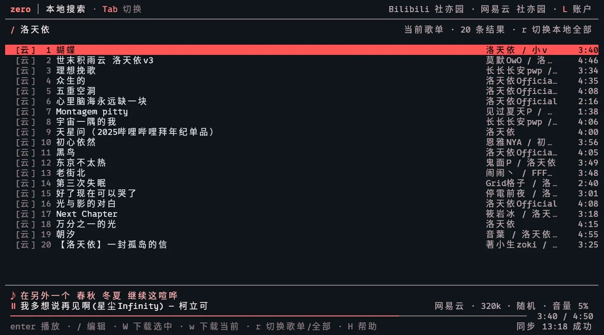

# 曲库、歌单与搜索

## 搜索

两个搜索页，别混淆：

- `/` 本地搜索：搜当前歌单，搜索页按 `r` 切换「当前歌单 / 本地全部」。
- `?` 音源搜索：搜 B 站或网易云，`s` 换源，`ctrl+u` / `ctrl+d` 翻页。
- 搜索结果里 `enter` 播放，`a` 加入歌单，`A` 加入队列。

## 收藏夹与远端歌单

- `f` 浏览并导入 B 站收藏夹 / 网易云歌单，按需导入；`s` 切换音源。
- 网易云「每日推荐」自动出现在歌单列表。
- 歌单焦点下按 `r` 重拉远端（同步刷新）。
- B 站收藏夹上限 300 首。

## 本地歌单

新建 / 重命名 / 删除：

- `N` 打开命令面板（新建本地或混合歌单、跨设备同步、解锁、关于）；歌单栏标题或空白处右键走同一个入口。
- `R` 重命名当前本地 / 混合歌单。
- `D` 在歌单焦点下删除当前歌单（同步歌单只删本地副本，平台歌单不受影响）。
- `a` 把选中或正在播放的歌加入目标歌单，`d` 从当前歌单移除。
- 本地歌单可混装 B 站 + 网易云两平台曲目。

## 混合歌单

一个歌单可引用多个歌单并追加自己的曲目：

- 引用源自动同步，自己的增删不写回源歌单。
- `S` 把当前选中歌单以引用方式混入另一个混合歌单（曲库）。
- `M` 编辑当前混合歌单的引用。
- 不支持嵌套；引用源被删除前需先在混合歌单里移除引用。

## 云端歌单写入

`a` 的目标列表包含同源云端歌单（B 站收藏夹、网易云歌单）：

- 写入需要登录，远端歌单仍需 `f` 导入后才会出现在曲库。
- 目前只支持「加歌」，不支持删除、改名或完整双向同步；写网易云时通常只能写自己创建的歌单。

## 解锁同步歌单

`U` 把当前同步歌单解锁为本地歌单，保留曲目并停止远端同步（Half-Beat 语义）。**解锁不可逆。**

## 批量选择与批量操作

曲库当前歌单的歌曲列表支持多选：`z`（或 `ctrl+space`）标记/取消标记当前歌曲，`ctrl+a` 全选/取消全选，`esc` 取消选择。选中行行首显示 `✓`，标题栏显示「已选 N 首」，底部提示切换成批量操作。

- `enter`：把选中项作为临时队列播放（选中两首及以上）。
- `a`：一次把选中项加入目标歌单（本地/混合/同源云端）。
- `W`：批量下载选中项。
- `e` / `E`：批量插到下一首播放 / 追加到队列末尾。
- `d` / `\`：从当前歌单批量移除（同步歌单只删本地副本，混合歌单只隐藏）。
- 右键任一已勾选行：打开批量菜单，菜单项同样标注快捷键。
- 鼠标：`Ctrl+左键` 勾选/取消勾选，`Shift+左键` 从上一个标记处连选。

选择按歌曲 ID 记录：切换歌单后自动失效，刷新后已不存在的歌曲也会自动从选择里去掉，不会把 A 歌单的选中项操作到 B 歌单。
