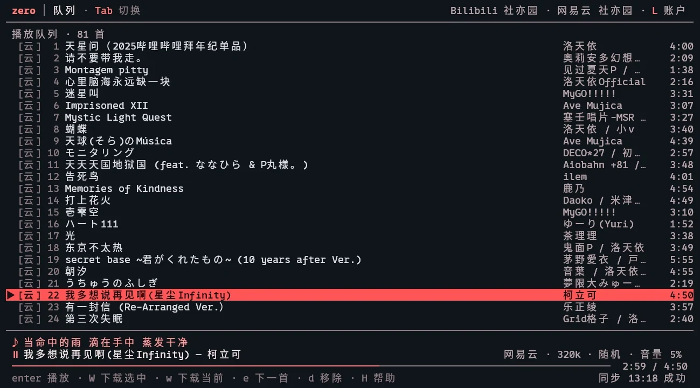

# 播放、队列与歌词

## 音质

- B 站优先 FLAC / 192k AAC-LC，网易云优先 320k。
- `y` 切换音质偏好：自动 / 高音质 / 无损，下一首生效。
- 播放直链不入库，每次播放时现解析（B 站约 2 小时、网易云约 20 分钟过期）。

## 稳定播放

- 按 CDN 过期时间续签，失败自动重解析重试一次。
- 顺序模式下提前解析下一首的音频地址，缩短切歌等待。注意这只是预解析地址，不是真无缝：切歌仍有极短的解码启动间隙，交叉淡入淡出还没做。
- seek 会重开 ffmpeg 进程，大约 0.3–1 秒的停顿，不是瞬时跳转。

## 音量

- `-` / `=` 音量 ∓5%，`m` 静音 / 恢复，切歌即时生效。
- `,` / `.` 音量补偿 ∓1 dB：用户音量叠加 dB 音量补偿，软限幅防削波。
- 鼠标滚轮在底部播放状态行上调节音量。

## 播放模式与队列

- `p` 切换播放模式：顺序 / 单曲 / 随机。随机为洗牌队列，进入/退出时重建。
- 随机模式下播放歌单会**先整体洗牌再起播**，第一首也是随机的；显式点某首歌时仍从那一首开始。退出随机恢复原顺序。
- `c` 打开播放列表（队列），支持混源队列。
- `g` 下一首播放，`J` / `K` 队列内上移 / 下移，`D` 清空队列。
- `e` / `E`：插到下一首播放 / 追加到队列末尾（歌曲焦点，多选时批量）。

## 播放片段

`C` 编辑当前歌曲的播放区间，只播放这一段：

- `{` / `}` 设起止，`ctrl+r` 清除。
- 编辑时可在整首范围移动，未设边界默认原曲首尾。
- 进度条与播放条显示区间。
- 片段存在 settings 里，播放引擎用 `-ss` / `-t` 实现（见 [ADR 0013](../adr/0013-clip-and-cloud-write.md)）。

## 歌词

- 来源优先级：B 站字幕 / 网易云官方歌词优先，没有时用 LRCLIB 兜底。LRCLIB 靠歌名与时长匹配，冷门版本可能匹配错。
- 网易云译文在原文下另起一行。
- 底部常驻当前一句，当前句随播放进度渐变到高亮。
- `<` / `>` / `0` 在任意视图调整歌词偏移 ∓0.5 秒 / 归零，并记住。
- `T`（或 `ctrl+l`）打开歌词页。

歌词页操作：中央一行固定为焦点行。`↑` / `↓` / `PgUp` / `PgDn` / `g` / `G` / 滚轮 / 单击移动焦点；`enter` 跳到焦点行并恢复跟随；`esc` 回到正在播放的行（再按一次返回曲库）；双击某句直接跳转。正在播放的行用蓝色渐变 + 左侧 `▶` 标出，浏览时的焦点行用灰底，两者不会混淆。

手动导入歌词还没做。

## 睡眠定时

`t` 循环 15 / 30 / 60 / 120 分钟，到点自动暂停。

## 本地优先播放

已下载歌曲默认优先播放本地文件，不校验音质（选中无损也照播本地版本）；文件不存在或解码失败会在重试时回落远程。可在命令面板里切换（`N`）；关掉后下载页的 `enter` 也走远程解析。详见[下载](download.md)。
