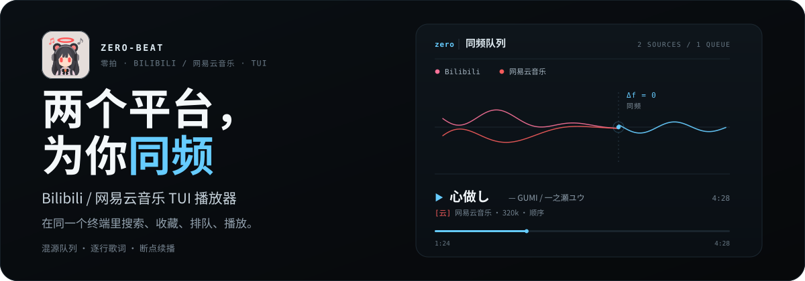

<div class="release-note">
  <strong>v0.6.1 已就绪</strong>
  <span>登录态过期冻结、单曲音量补偿与自动响度均衡</span>
  <a href="./changelog/v0.6.1.html">发布说明 →</a>
</div>



## 一行安装

```bash
curl -fsSLO https://github.com/Sheyiyuan/zero-beat/releases/latest/download/install.sh
sh install.sh && zero
```

还需要系统 `ffmpeg` 负责音频解码。官方支持 Linux 和 macOS，Arch 有 AUR 包 `zero-beat-git`；Windows 提供了 zip 包，需要自己准备好 ffmpeg 和终端环境。

## 界面

<ShotCarousel />

## 文档地图

- 用户先看：[安装](/guide/install) → [快速上手](/guide/quickstart) → [按键速查](/reference/keys)
- 功能专题：[曲库与歌单](/guide/library)、[播放与歌词](/guide/playback)、[下载](/guide/download)、[跨设备同步](/guide/sync)、[系统媒体](/guide/sysmedia)、[主题与配色](/guide/theme)
- 配置参考：[自定义快捷键](/reference/keymap)、[CLI 子命令](/reference/cli)
- 上手前建议读：[已知限制](/guide/limitations)、[数据与隐私](/guide/privacy)

## 免责声明

本项目仅供学习、研究与技术交流，不用于商业用途。B 站与网易云的音频、视频、封面、商标等内容版权归对应平台及权利人所有，本项目不托管任何音源内容；使用可能遇到账号风控、封禁、接口失效或数据丢失，风险自担。完整条款见[数据与隐私](/guide/privacy#免责声明)。

许可证：[AGPL-3.0](https://github.com/Sheyiyuan/zero-beat/blob/main/LICENSE)。
